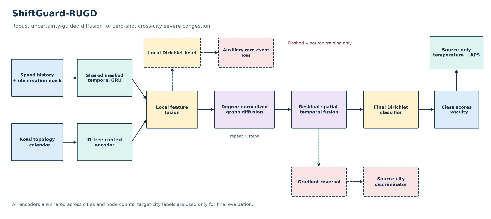

# ShiftGuard-RUGD

### Reliable zero-shot traffic-congestion prediction across cities

[](https://www.python.org/)
[](https://pytorch.org/)
[](#verification)
[](#evaluation-protocol)

ShiftGuard-RUGD is a research codebase for **rare and severe traffic-congestion
classification under zero-shot cross-city distribution shift**. It combines normalized graph diffusion, evidential uncertainty, rare-event objectives,
source-city alignment, calibration, and shift stress tests in a reproducible pipeline.

The project uses the public **OpenCity TrafficCD, TrafficHZ, and TrafficSH datasets**. Synthetic
data is not used for reported experiments. It is designed for a single GPU with about 16 GB of
memory.

> **Research integrity.** Target-city labels are never used for training, validation,
> hyperparameter selection, normalization, threshold selection, or calibration. The repository
> makes no unsupported state-of-the-art claim, and paper-derived baselines are identified as
> protocol adaptations rather than claimed official reproductions.



## Why this project?

Traffic models often perform well within their training city while degrading on an unseen road
network—especially for rare severe events. This project studies four questions together:

1. Can a model transfer to a city whose labels were never observed?
2. Can it retain recall and precision on rare severe congestion?
3. Does its confidence remain meaningful after transfer?
4. How robust is it to missing sensors, measurement noise, and temporal shift?

ShiftGuard-RUGD uses a lightweight recurrent graph architecture rather than a large pretrained
foundation model. Its core mechanism, **Robust Uncertainty-Guided Diffusion (RUGD)**, couples simple
degree-normalized graph transport with local evidential supervision, rare-event learning, and
source-domain alignment before recurrent fusion.

## Model comparison

| Family | Model | Purpose in this repository |
|:--|:--|:--|
| Sanity checks | Prior, persistence | Non-learned lower bounds |
| Classical | Logistic regression, histogram GBDT, LightGBM | Feature-based controls |
| Recurrent | GRU, Graph-GRU | Lightweight temporal/spatiotemporal controls |
| Modern adaptation | STAEformer-Inductive | Transferable temporal/spatial attention |
| Modern adaptation | UIGNN-Inductive | Diffusion, masked recovery, and evidential prediction |
| Modern adaptation | OpenCity-Scratch | Source-only patch/time/graph Transformer |
| Proposed | **ShiftGuard-RUGD** | Robust uncertainty-guided normalized graph diffusion |

Released OpenCity checkpoints are intentionally not used because their official pretraining setup
contains evaluation cities and would contaminate zero-shot evaluation. See
[Modern Baselines](docs/MODERN_BASELINES.md), [Novelty](docs/NOVELTY.md), and the
[2021–2025 Literature Review](docs/LITERATURE_2021_2025.md) for scope and attribution.

## Evaluation protocol

For each held-out target city, the other two cities provide chronological source training,
calibration, and validation partitions. The target contributes only its final chronological test
partition. An embargo separates partitions. Normalization statistics and warning/severe class
thresholds are fitted only on source training data.

Final experiments use seeds **17, 42, and 2025** and report:

- macro-F1, accuracy, balanced accuracy, and per-class precision/recall/F1;
- severe-event AUPRC and AUROC;
- NLL, Brier score, ECE, ACE, and uncertainty–error correlation;
- conformal coverage and prediction-set size;
- missing-sensor, measurement-noise, and temporal-shift robustness;
- parameter count, training time, latency, and throughput;
- paired bootstrap intervals, Wilcoxon tests, rank-biserial effects, Holm correction, and
  city-level sign-flip sensitivity analysis;
- component ablations with matched seeds and partitions.

Hyperparameters are selected with a city-balanced source-validation objective combining clean and
30%-missing macro-F1 with severe-event AUPRC. Lightweight models receive 20 trials per city;
compute-intensive Transformers receive 8 wall-clock-compute-matched trials per city. This budget
must be disclosed when interpreting comparisons.

## Installation

```powershell
git clone https://github.com/anonymous-rugd/rugd.git
cd rugd
python -m venv .venv
.venv\Scripts\Activate.ps1
python -m pip install --upgrade pip
pip install -e ".[tuning,demo,dev]"
```

Linux/macOS users should activate with `source .venv/bin/activate`.

## Dataset

Download and validate the public OpenCity files:

```powershell
python scripts/download_opencity.py
```

Expected local layout (ignored by Git):

```text
data/open_city/raw/
|- TrafficCD/
|  |- TrafficCD.npz
|  `- TrafficCD_rn_adj.npy
|- TrafficHZ/
|  |- TrafficHZ.npz
|  `- TrafficHZ_rn_adj.npy
`- TrafficSH/
   |- TrafficSH.npz
   `- TrafficSH_rn_adj.npy
```

The loader verifies shapes and creates auditable data manifests. Raw dataset files are excluded from version control. The complete retained final-study outputs,
including checkpoints and predictions, are versioned for reviewer auditability.

## Configuration

- `configs/experiment.yaml` is the reusable full-study template used by tuning, main-study, ablation, and verification launchers.
- `configs/smoke.yaml` is the reduced-budget template used by the smoke launcher.
- `outputs/studies/final_study/configs/` contains frozen configurations from the completed study; these are audit artifacts rather than editable launch defaults.
## Verification

Before a long run:

```powershell
python -m pytest -q
python scripts/verify_modern_models.py --batch-size 12 --backward
```

The first command runs the automated tests. The second performs real forward and backward passes
for every modern model on the largest graph.

## Reproduce the complete study

On a fresh clone, run the exact final 11-model suite directly:

```powershell
python scripts/run_full_pipeline.py --study-id final_reproduction --baseline-trials 30 --trials 20 --transformer-trials 8
```

If interrupted, resume without repeating completed tuning configurations or runs:

```powershell
python scripts/run_full_pipeline.py --study-id final_reproduction --baseline-trials 30 --trials 20 --transformer-trials 8 --resume
```

The launcher sequentially performs source-only tuning, three-seed main evaluation,
robustness/calibration analysis, RUGD ablations, statistical tests, plots, and report generation.
Do not launch its stages concurrently on one GPU.

Detailed stage commands and output contracts are in
[OpenCity Outputs](docs/OPENCITY_OUTPUTS.md).

## Streamlit demo

After producing a study:

```powershell
streamlit run app.py
```

The dashboard explores city/model comparisons, rare-event behavior, calibration, uncertainty,
robustness curves, and generated artifacts.

## Repository structure

```text
ShiftGuard-RUGD/
|- app.py                              # Streamlit result explorer
|- configs/                            # Full and smoke configurations
|- docs/                               # Protocol, model, literature, and final-results docs
|- scripts/
|  |- download_opencity.py             # Dataset acquisition and validation
|  |- launch_tuning.py                 # Source-only Optuna tuning
|  |- launch_main_study.py             # Three-city, three-seed evaluation
|  |- launch_ablations.py              # Matched RUGD ablations
|  |- run_full_pipeline.py             # One-command final pipeline
|  `- export_results_report.py         # Detailed final Markdown report
|- outputs/studies/final_study/       # Complete retained results and checkpoints
|- src/traffic_ml/                     # Data, models, losses, metrics, statistics, reporting
|- tests/                              # Deterministic automated tests
|- pyproject.toml
`- README.md
```

Raw data, disposable experiment outputs, local environments, and temporary artifacts remain
untracked. Only reusable source, documentation, and the retained final study are versioned.

## Reproducibility and audit trail

Every run records resolved YAML, seeds, environment metadata, data hashes, checkpoints,
predictions, per-seed metrics, and timestamped logs. Aggregate tables contain means and standard
deviations rather than selected best-seed values. The final-study checksum manifest records SHA-256 values for retained model and prediction artifacts. Progress bars are nested by pipeline stage, search, trial, run, and epoch.

## Documentation map

- [Protocol and leakage controls](docs/OPENCITY_PROTOCOL.md)
- [Mathematical specification](docs/SHIFTGUARD_MATH.md)
- [Novelty and limitations](docs/NOVELTY.md)
- [Modern baseline adaptations](docs/MODERN_BASELINES.md)
- [Metrics and generated artifacts](docs/OPENCITY_OUTPUTS.md)
- [Literature review, 2021–2025 only](docs/LITERATURE_2021_2025.md)
- [Final study results](docs/FINAL_RESULTS.md)

## Study scope

The checked-in `final_study` directory is the final retained study. It reports all three fixed seeds and all configured
held-out cities. Its checksum manifest is stored at
`outputs/studies/final_study/FINAL_STUDY_MANIFEST.json`. Publication-level confirmation still
requires evaluation on new cities or another dataset.

## Limitations

The study covers three cities and road-sensor graphs; external validity beyond these settings
requires more datasets. Modern baselines are task adaptations, not bit-identical official
reproductions. Three seeds support paired analysis but do not replace evaluation across more
cities. The retained final-study tables and figures are generated from the complete final pipeline.

## Citation

This repository is under active research development. Until an archival identifier is available, cite the repository URL and the exact commit hash used for the experiment.
